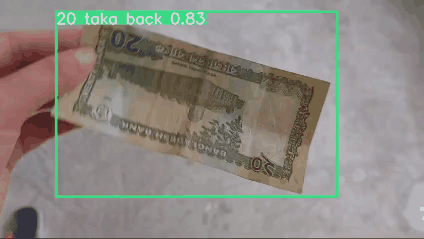
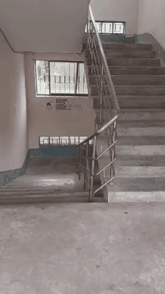
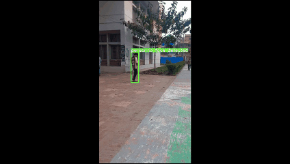

# Automated Object Identification for the Visually Impaired

A real-time assistive vision system that helps visually impaired people find their way indoors, handle money and recognise familiar people. The models run on the frames of a single camera feed:

- **Object detection** (YOLOv5s): finds 8 classes common indoors: chair, table, door, stairs, wardrobe, person, commode and currency. 
- **Currency classification** (YOLOv5s classifier): when a banknote is detected, the note is cropped and classified into one of 9 Bangladeshi denominations, front or back (18 classes in total). 
- **Face recognition** (OpenCV DNN face detector + ResNet-50 embeddings): when a person is detected, the face is found inside the person box and matched against stored embeddings of known people using cosine distance.

This repository holds the code for the paper **"Automated Object Identification for the Visually Impaired"**, presented at the *27th International Conference on Computer and Information Technology (ICCIT 2024)*, Cox's Bazar, Bangladesh. The paper is on [IEEE Xplore](https://ieeexplore.ieee.org/document/11022362) (DOI: [10.1109/ICCIT64611.2024.11022362](https://doi.org/10.1109/ICCIT64611.2024.11022362)).

## Demo

| Currency recognition | Stair detection | Person detection |
|:---:|:---:|:---:|
| [](object-id-currency-demo.mp4) | [](object-id-stairs-demo.mp4) | [](object-id-person-demo.mp4) |
| A detected note is cropped and passed to the currency classifier | Stairs are flagged as a fall hazard | Each detected person is passed to face recognition |

Click a clip to open the full-quality video.

## How it works

```
camera frame
    │
    ▼
YOLOv5s object detector ── chair / table / door / stairs / wardrobe / commode ──► label
    │
    ├── currency ──► crop ROI ─► resize 224×224 ─► YOLOv5s classifier ─► "<value> taka <front|back>"
    │                                                (shows "currency value not detected" if confidence < 0.5)
    │
    └── person ────► crop ROI ─► (histogram equalisation if low light)
                         ─► OpenCV DNN face detector (SSD, ResNet-10)
                         ─► ResNet-50 embedding ─► cosine distance to known faces
                         ─► name if distance < 0.35, else "unknown"
```

## Results

Results as reported in the paper:

| Module | Test set | Result |
|---|---|---|
| Object detection (YOLOv5s, 300 epochs, batch 64) | 2,188 images / 5,506 instances | **98.2% mAP**, precision 96.8%, recall 96.1%, F1 96.5% |
| Currency classification (YOLOv5s-cls) | 374 images | **99.7% top-1 accuracy** |
| Face recognition (ResNet-50 + cosine similarity) | 128 images of 24 people | **97.6% accuracy**, precision 99.2%, recall 98.4% |

<details>
<summary>Per-class object detection results</summary>

| Class | Instances | Precision | Recall | F1 | mAP |
|---|---:|---:|---:|---:|---:|
| Chair | 1528 | 97.2% | 98.0% | 97.6% | 99.2% |
| Table | 489 | 96.8% | 95.5% | 96.0% | 98.6% |
| Door | 342 | 97.8% | 99.1% | 98.5% | 99.3% |
| Stairs | 317 | 93.4% | 90.0% | 91.7% | 95.3% |
| Wardrobe | 85 | 98.3% | 98.8% | 98.6% | 99.3% |
| Person | 2373 | 92.4% | 88.0% | 91.0% | 94.9% |
| Commode | 43 | 98.9% | 100.0% | 99.5% | 99.5% |
| Currency | 329 | 100.0% | 99.7% | 99.8% | 99.5% |

</details>

## Datasets

All three datasets are custom-made for this project and are not included in this repository.

- **Objects:** 16,959 images of the 8 classes, mostly photographed by the authors. Annotated in YOLO format with labelImg, resized to 640×640 and split 70/20/10 for train/val/test. https://www.kaggle.com/datasets/humairaanzumneha/final-dataset
- **Currency:** 2,444 images of the 9 current Bangladeshi banknotes (2, 5, 10, 20, 50, 100, 200, 500 and 1000 taka), front and back, giving 18 classes. Photographed on a white background, resized to 224×224 and split 70/20/10. https://www.kaggle.com/datasets/humairaanzumneha/currencyds
- **Faces:** 24 people. Each recorded a 10-second video turning their head, and 20 frames per video were sampled to build the stored embeddings.

## Repository layout

```
├── detecttestingexperimeta.py   # original pipeline script (Windows paths)
├── weight/
│   ├── objectbest.pt            # YOLOv5s detector, 8 classes
│   └── currencybest.pt          # YOLOv5s classifier, 18 currency classes
├── Face/
│   ├── Facemodule.py            # recognize_face(): face detection + embedding match
│   ├── generateandstoreembedding.py
│   ├── Resnet50Cosine.py
│   ├── deploy.prototxt.txt      # OpenCV DNN face detector
│   ├── res10_300x300_ssd_iter_140000.caffemodel
│   └── resnet50embeddings.pickle
├── myyolov5-main/               # YOLOv5 codebase (models/, utils/, data/)
│   └── detect_mac.py            # macOS/Linux copy of the pipeline script
└── object-id-*-demo.{mp4,gif}   # demo clips
```

## Running it

Tested on macOS with Python 3.13, CPU only.

```bash
python3 -m venv .venv
.venv/bin/pip install -r myyolov5-main/requirements.txt dill "setuptools<81"

cd myyolov5-main

# on an image, a folder or a video
TORCH_FORCE_NO_WEIGHTS_ONLY_LOAD=1 ../.venv/bin/python detect_mac.py --source path/to/image.jpg

# live from the webcam
TORCH_FORCE_NO_WEIGHTS_ONLY_LOAD=1 ../.venv/bin/python detect_mac.py --source 0 --view-img
```

Annotated output is saved to `myyolov5-main/runs/detect/exp*/`.

Notes:
- `TORCH_FORCE_NO_WEIGHTS_ONLY_LOAD=1` is needed because PyTorch 2.6 and later refuse to open full-model YOLOv5 checkpoints like these without it. `dill` is needed because the checkpoints were saved with it.
- On macOS the terminal app, or VS Code, needs camera access: System Settings → Privacy & Security → Camera.
- `detecttestingexperimeta.py` is the original Windows script. `detect_mac.py` is the same pipeline with the Windows-only path handling and hard-coded `C:\`/`D:\`/`E:\` paths fixed.
- **Face recognition** depends on `keras_vggface`, which does not install on current Python or TensorFlow. Without it, `detect_mac.py` still runs object detection and currency classification, and labels people as "no face detected". To enable face recognition, use an older environment (Python 3.9 or 3.10 with TensorFlow 2.x and `keras_vggface`) and run from a directory where `Face/` model files resolve.

## Citation

```bibtex
@inproceedings{neha2024automated,
  title     = {Automated Object Identification for the Visually Impaired},
  author    = {Neha, Humaira and Sadi, Muhammad Sheikh and Islam, Md. Repon and Sakib, Sadman},
  booktitle = {2024 27th International Conference on Computer and Information Technology (ICCIT)},
  address   = {Cox's Bazar, Bangladesh},
  publisher = {IEEE},
  year      = {2024},
  month     = dec,
  pages     = {3584--3589},
  doi       = {10.1109/ICCIT64611.2024.11022362}
}
```

## Acknowledgements

Built on [Ultralytics YOLOv5](https://github.com/ultralytics/yolov5). Department of Computer Science and Engineering, Khulna University of Engineering & Technology (KUET).
